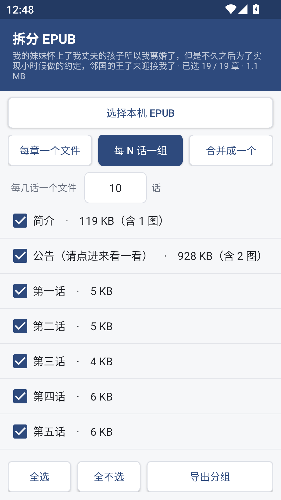

# ESJ 收藏下载 · ESJZone Reader

一个 Android 客户端：登录你自己的 ESJZone 账号，把「我的收藏」里的书抓下来，在手机上直接打包成 EPUB。

> 这是一个**下载工具**，不是一个内容仓库。仓库里只有代码，没有任何小说内容。

---

## ⚠️ 内容标注与使用前提（请先读这一段）

| 项目 | 说明 |
| --- | --- |
| **仓库内容** | 只有 Android 应用源码、构建脚本与测试工具。**不包含任何小说、EPUB 或站点数据。** `.gitignore` 里明确排除了 `*.epub` 与 `testdata/`，避免误提交书籍内容 |
| **版权归属** | 所有小说的版权归原作者、译者与 ESJZone 站点所有。本项目不主张任何内容权利 |
| **账号** | 必须使用**你自己的** ESJZone 账号。应用不内置任何账号、Cookie 或凭据，Cookie 只存在你本机的应用私有存储里 |
| **内容分级** | 站点包含 R18 内容。应用会**原样**下载并打包它，不做过滤，也不做内容审查 |
| **用途限定** | 仅供**个人备份**你本就有权阅读的内容。请遵守站点服务条款与所在地法律 |
| **禁止用途** | 请勿用本工具批量抓取后二次分发、再上传或商业利用。那与作者和站点直接冲突 |
| **合规** | 若你是权利人并认为本项目有问题，请提 issue，会及时处理 |

如果你所在地区访问该站点受限，或你不接受上述前提，请不要使用本项目。

---

## 功能

界面是四格底部导航：**收藏 / 下载 / 已下载 / 工具**。

### 收藏
- 在应用内用 WebView 正常登录，登录成功自动返回（靠检测页面上只有登录用户才渲染的会员菜单）
- 读取「我的收藏」，支持搜索、按**最新收藏 / 最新更新**排序、多页合并
- 点一本书进入**选章页**：按卷分组、卷标题可整卷勾选、全选 / 全不选、显示「已选 N / M 章」
- 也可以「全部下载」一键跳过选择

### 下载
- 前台 Service 承载下载，**离开界面不中断**；进程被杀后下次启动自动续传
- 队列持久化在本地，通知栏显示进度
- 实时显示：**已下载 MB**、章节进度、**已发现插图数量**、插图下载进度
- 有任务在跑时**强制亮屏**，全部结束或离开页面即释放

### 已下载
- 显示体积、章数、图数、完成时间，可打开、查看文件位置、从列表移除

### 工具（完全离线，不联网）
- **按章节拆分 EPUB**：可从本机任选 `.epub`，列出每章**大小与图片数**，三种导出方式：
  - 每章一个文件
  - **每 N 话一组**（每 N 章合成一个，文件名为 `书名 - 001-003.epub` 序号区间）
  - 合并成一个
- **压缩插图**：长边压到 1600px、JPEG q82，逐张处理并带采样解码，大书也不 OOM

## 截图



---

## 安装

```
dist/ESJZone-Reader-1.0.apk
```

- `minSdkVersion 21`（Android 5.0+），`targetSdkVersion 33`
- **不含任何原生库**（APK 里没有 `lib/`），纯 Java，因此 32 位 ARM（armeabi-v7a）可直接运行
- 已用 v1 + v2 + v3 签名。**签名密钥不在仓库里**，你自行构建的包与这个 APK 签名不同，无法覆盖安装

## 构建

不依赖 Gradle 和 Android Studio，直接走 `aapt2 → javac → d8 → zipalign → apksigner`：

```powershell
powershell -ExecutionPolicy Bypass -File build.ps1 `
  -SdkRoot  "C:\Android\Sdk" `
  -JavaHome "C:\Program Files\Java\jdk-11"
```

需要：

- JDK 11
- Android SDK 里的 `build-tools`（含 `aapt2`、`d8`、`zipalign`、`apksigner`）与 `platforms/android-33/android.jar`
- Python 3（构建脚本用它在 zip 里拼 APK）

签名密钥首次构建时由 `keytool` 自动生成到 `keystore/`（**已被 `.gitignore` 排除，切勿提交**）。

重新取依赖（jsoup 与繁转简字表，需要联网）：

```powershell
python tools/fetch_deps.py
```

---

## 实现中踩到的坑（也是这个项目的主要价值）

这些是拿真实登录页面和真机逐个验证出来的，不是照抄旧脚本。

### 1. 收藏夹和公开列表页不是一套结构

| | 公开列表页 `/list-21/` | 收藏夹 `/my/favorite` |
| --- | --- | --- |
| 书卡容器 | `div.col-lg-3.col-md-4...` | **`div.product-item`** |
| 每页 | 40 | **18** |
| 分页 | `/list-21/2.html` | **`/my/favorite/2`（无 `.html`）** |
| 封面图 | 有 | **无** |

镜像仓库那份 2024 年的 `esj.py` 用 `col-lg-3`，套到收藏夹上**一本都抓不到**。

### 2. 目录里有游离的 `<summary>`

详情页 `#chapterList` 里有 **3 个 `<summary>` 但只有 2 个 `<details>`**——「正文」这一卷不在任何 `<details>` 里。`esj.py` 的 `contentsAnalysis` 只认 `<details>` / 非空 `<p>` / `<a>`，会把这个裸 `<summary>` 整个忽略，导致那 254 章失去归属。本项目的 `DetailParser` 把裸 `<summary>` 当卷处理。

### 3. 作者不再是链接

新站的 `ul.book-detail > li` 全是纯文本（`作者: xxx`），没有 `<a>`。`esj.py` 用 `bookAuthorTag.find("a").text` 取作者，照抄会得到空字符串。这里改成按 `作者:` 标签解析。

### 4. 未登录是"软拦截"，不是 403

站点对未登录请求返回 **HTTP 200 + 論壇首页**，不跳转也不报错。所以只能检测页面里有没有预期结构（`Fetcher.looksSignedOut`），不能看状态码。实测四种页面（软拦截页 / 收藏夹 / 详情页 / 章节页）判定全部正确。

### 5. 死域名混用

收藏夹页面里 **12/18 张卡片的「最新章节」链接指向 `www.esjzone.cc`**，而该域名已连不上（实测超时 / 连接重置），只有 `www.esjzone.one` 可用。所有 URL 都过一遍 `Site.canonical()` 重写。

### 6. jsoup 版本必须锁 1.14.3

`minSdk 21` 要求能在 Android 5/6 上跑。jsoup 1.15+ 内部用了 `java.util.stream` / `Optional`，d8 **不会脱糖也不报警告**，构建照过，但老设备上会 `NoClassDefFoundError`。详见 [THIRD-PARTY.md](THIRD-PARTY.md)。

### 7. Android 7 以下要手动开 TLS 1.2

站点要求 TLS 1.2+，而 API 21–23 的 `HttpURLConnection` 默认不开。`Net.java` 显式设置 `SSLContext("TLSv1.2")`。

### 8. 老版本的存储权限差异

运行时存储权限只存在于 Android 6–9；10+ 走 MediaStore 不需要权限；5.0/5.1 是安装时授予。三档都做了区分，避免调不存在的 API。

---

## 测试

### 真机 / 模拟器

| 环境 | 结果 |
| --- | --- |
| MuMu 模拟器（Android 12，API 32，x86_64） | 四个页面切换正常；图片压缩 30.9 MB → 5.1 MB（19 张图缩了 15 张）；按章拆分产出 234 章；**每 N 话一组** 19 章按 3 组导出 7 个文件，拉回逐个校验章数 3/3/3/3/3/3/1，全部通过 |
| 真机 OPPO Watch（Android 11，API 30，**仅 armeabi-v7a**） | 安装并运行，378×496 小屏下登录页 / 主界面 / 工具页 / 拆分页布局均正常 |

### 离线（桌面 JVM + Python）

`tools/` 下是可直接跑的验证脚本：

```powershell
python tools/lint_resources.py           # 布局与资源检查（已并入 build.ps1）
python tools/validate_epub.py <a.epub>   # EPUB 结构校验
python tools/check_softblock.py          # 软拦截识别
python tools/audit_dex.py                # dex 完整性 / Java 8 API 泄漏
```

- 收藏夹解析：18/18，字段全对，死链重写残留 0
- 详情页目录树：**268 章 = 268 个链接**，3 卷（5 + 9 + 254）
- 拆分：3 本真实镜像 EPUB（2 / 79 / 19 章）单章与合并导出，6 个产物全部通过结构校验
- 分组：19 章按 N=3 → 7 个文件，覆盖 19 章无遗漏无重复；N 取值钳制 `0/1→2`、`abc→10`、`9999→500`

### 一个真实的线上事故

第一版 APK 一打开就闪退，真机 logcat：

```
InflateException: Binary XML file line #61 in layout/activity_main:
You must supply a layout_width attribute.
```

根因是两个按钮样式只定义了 `layout_height`，而三个按钮没在任何地方写 `layout_width`。这类 bug **所有离线测试都碰不到**（解析器、EPUB、dex 审计全绿），只有真正膨胀布局才暴露。修复方式是把检查固化：`tools/lint_resources.py` 沿 style 链解析布局属性，并**并入 `build.ps1`**，资源有问题直接中断构建。

---

## 已知限制

- 抓取依赖站点当前 HTML 结构，站点改版会导致解析失效——解析器全部集中在 `*Parser.java`，改版后改这几处即可
- 密码章节会跳过并在 EPUB 里留占位说明；被举报章节会尝试 `forum_report` 地址重试
- 章节正文会被拍平成纯文本段落（加粗、字号等行内样式不保留），插图按原位置嵌入
- 大书的一次性章节文本常驻内存（一本长篇约数 MB 字符串）；插图是流式落盘，不占内存

## 许可

代码以 **GPL-3.0** 发布，见 [LICENSE](LICENSE)。第三方组件许可见 [THIRD-PARTY.md](THIRD-PARTY.md)。

## 免责声明

本项目与 ESJZone 官方无任何关联，未被其授权或认可。使用本工具产生的一切后果由使用者自行承担。

---

## 更新记录（v1.3）

这一轮全部来自真机使用中暴露的问题，每个都有可复现的证据。

### 1. 拆分后章节点不开（`toc.ncx` 地址错误）

拆分产物里 `nav.xhtml` 是对的，但 `toc.ncx` 里的 `content src` 写成了**从压缩包根开始**的路径：

```xml
<!-- 错：ncx 自己在 OEBPS/ 里 -->
<content src="OEBPS/chap_0141.xhtml"/>
<!-- 对 -->
<content src="chap_0141.xhtml"/>
```

阅读器（Librera、大部分安卓阅读器）的章节目录由 NCX 驱动，点击时地址解析不到文件就会报错，表现为「只有当前章能看、点别的章节打不开」。已改为相对 `toc.ncx` 自身的路径。

**同时补上了漏掉的校验**：`tools/validate_epub.py` 现在会逐条检查 nav 的 `a@href` 与 ncx 的 `content@src` 能否解析到真实条目，解析不到直接判失败——这正是当初漏掉这个 bug 的原因（旧脚本只数了条目数量）。

### 2. 简介没有写进元数据

原先只生成了一个「简介」页面，OPF 里没有 `dc:description`，所以阅读器的书籍信息面板看不到简介。现在下载与拆分两条链路都会写入：

```xml
<dc:subject>日轻</dc:subject>
<dc:description>我的名字叫矢野亮。长得非常普通……</dc:description>
<dc:source>https://www.esjzone.one/detail/...</dc:source>
<meta name="cover" content="coverimage"/>
```

拆分时会从源文件继承这些字段，不会因为拆分丢失。

### 3. 新增「仅下载文字」

选章页的勾选框，跳过插图与封面，并把正文里的插图块**移除**（而不是留下指向外网的死链），因此产出的 EPUB 里 `` 数量为 0。任务级开关，随队列持久化。

### 4. 下载慢：不可达的插图会拖死整个任务

插图托管在 `telegra.ph`，某些网络下不可达（实测 DNS 被污染到 `157.240.3.50`）。原逻辑对每张图重试 3 次、每次 12 秒连接超时，并且**失败完全静默**——50 张图的书写完正文后要空等半小时，界面上看起来就是卡住。

现在的处理：

- 插图请求改为 **1 次尝试、8 秒连接超时**
- **连续 3 张失败即判定站点不可达**，跳过剩余插图并明确告知
- 失败不再静默：计数、写日志（`adb logcat -s ESJ`）、界面显示「N 张失败」
- 插图下载改为 **5 线程并行**（原来是串行，一张一张来）
- 章节下载线程 4 → 6

同时修掉一个隐性 bug：已下载字节数用 `bytesDone += n` 非原子累加，多线程下更新丢失，进度里的 MB 会冻住不动。现在加锁累加。

实测同一本 106 章的书：配好代理后 106 章 + 50 张图（6.8 MB 图片）一次跑完约 85 秒；无代理时会快速跳过不可达的插图并正常出书，而不是卡半小时。

### 5. 32 位真机适配

在 OPPO Watch（Android 11 / API 30 / **仅 armeabi-v7a** / 378×496）上安装并运行，登录页、主界面、工具页、拆分页布局均正常。